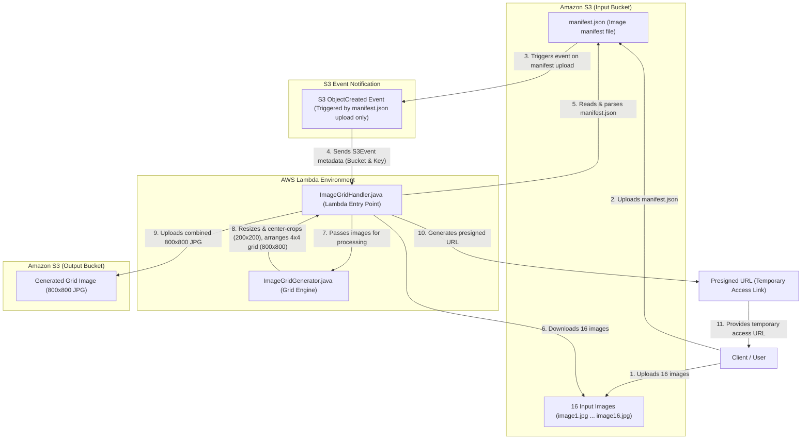

# Serverless Image Grid Generator (Java 21 + AWS Lambda)

A serverless, event-driven image processing application built with **Java 21**, **AWS Lambda**, and **Amazon S3**. The application is designed to take exactly 16 input images referenced by a `manifest.json` file in an S3 input bucket, resize and center-crop each image to 200 × 200 pixels, composite them into a single 4 × 4 grid (800 × 800 pixels JPG), upload the output image to a separate S3 output bucket, and generate a temporary presigned URL for secure access.

> [!NOTE]
> **Current Project Status:** Local image processing and grid composition are fully implemented and verified via `Main.java`. The AWS Lambda handler (`ImageGridHandler.java`) has its initial foundation completed (S3 event receiving, validation, downloading `manifest.json`, and converting it to a UTF-8 string). Full cloud pipeline features (JSON parsing, batch image download from S3, S3 upload, and presigned URL generation) are actively in progress.

---

## 📋 Table of Contents

- [1. Project Overview](#1-project-overview)
- [2. Technology Stack](#2-technology-stack)
- [3. Project Structure](#3-project-structure)
- [4. Completed Work](#4-completed-work)
  - [ImageGridGenerator.java (Core Processing Engine)](#imagegridgeneratorjava-core-processing-engine)
  - [Main.java (Local Runner & Verification)](#mainjava-local-runner--verification)
  - [ImageGridHandler.java (AWS Lambda Entry Point)](#imagegridhandlerjava-aws-lambda-entry-point)
- [5. Current Project Progress](#5-current-project-progress)
- [6. Remaining Development Tasks](#6-remaining-development-tasks)
- [7. AWS Deployment Tasks](#7-aws-deployment-tasks)
- [8. Reliability, Security, and Optimization](#8-reliability-security-and-optimization)
- [9. Final System Architecture](#9-final-system-architecture)
  - [Intended Workflow Flow](#intended-workflow-flow)
  - [Architecture Flowchart (Mermaid)](#architecture-flowchart-mermaid)
- [10. Local Development & Testing](#10-local-development--testing)
  - [Prerequisites](#prerequisites)
  - [Compiling and Running Locally](#compiling-and-running-locally)
  - [Building for AWS Lambda (Fat / Uber JAR)](#building-for-aws-lambda-fat--uber-jar)
  - [AWS Lambda Configuration Reference](#aws-lambda-configuration-reference)
- [11. Learning Progress](#11-learning-progress)

---

## 1. Project Overview

The goal of this project is to construct a scalable, serverless microservice using AWS Lambda and Amazon S3 to automate the generation of image photo grids.

### Core Functional Requirements
- **Input:** Accept exactly 16 input images stored in an Amazon S3 input bucket.
- **Manifest File:** Read and extract image filenames and their grid order from a `manifest.json` file.
- **Trigger Mechanism:** Process image grids on demand, triggered when `manifest.json` is uploaded to S3.
- **Image Processing:** Download the 16 images from S3, resize and center-crop each image to 200 × 200 pixels (preserving aspect ratio without distortion).
- **Grid Composition:** Assemble all 16 images into a 4 × 4 layout on an 800 × 800 pixel canvas.
- **Output Storage:** Save the resulting composite image as an 800 × 800 JPG file in a dedicated Amazon S3 output bucket.
- **Secure Retrieval:** Generate an AWS S3 presigned URL granting temporary, secure read access to the generated image grid.

---

## 2. Technology Stack

The project relies on modern Java standards and AWS enterprise SDK libraries:

| Technology | Role & Purpose |
| :--- | :--- |
| **Java 21 (LTS)** | Core programming language leveraging modern Java performance and runtime features |
| **Apache Maven** | Dependency management, lifecycle automation, and project build tool |
| **AWS Lambda** | Serverless compute service executing code without provisioning or managing servers |
| **Amazon S3** | Scalable object storage for input images, manifest files, and generated output grids |
| **AWS SDK for Java v2 (`s3`)** | Modern, non-blocking Java SDK for Amazon S3 object retrieval and presigned URL creation |
| **AWS Lambda Java Core (`1.2.3`)** | Core interfaces for AWS Lambda runtime (`RequestHandler`, `Context`, `LambdaLogger`) |
| **AWS Lambda Java Events (`3.14.0`)** | Predefined event models to parse S3 Event notifications (`S3Event`, `S3EventNotification`) |
| **JUnit 5 (`5.10.2`)** | Modern unit testing framework for handler and logic verification |
| **Maven Shade Plugin (`3.6.0`)** | Packages compiled classes and external dependencies into a single deployable Uber/Fat JAR |

---

## 3. Project Structure

The codebase is organized according to standard Maven conventions:

```text
image-grid-generator/
├── README.md                                          # Project documentation and progress tracking
├── pom.xml                                            # Maven project configuration and dependencies
├── .gitignore                                         # Git ignore rules for build artifacts and IDE files
├── input-images/                                      # Sample local images (16 JPGs) for local testing
├── output-grid.jpg                                    # Local test output generated by Main.java
└── src/
    ├── main/
    │   ├── java/
    │   │   └── com/
    │   │       └── example/
    │   │           └── imagegrid/
    │   │               ├── ImageGridGenerator.java    # Core image reading, resizing, cropping & grid logic
    │   │               ├── ImageGridHandler.java      # AWS Lambda entry point (RequestHandler)
    │   │               └── Main.java                  # Local development runner & test harness
    │   └── resources/                                 # Application resources and configs
    └── test/
        └── java/
            └── com/
                └── example/
                    └── imagegrid/
                        └── ImageGridHandlerTest.java  # Unit tests for the handler
```

---

## 4. Completed Work

Detailed breakdown of currently implemented and tested components:

### ImageGridGenerator.java (Core Processing Engine)
A dedicated, reusable image processing class built using standard Java 2D APIs (`BufferedImage`, `Graphics2D`, `ImageIO`):
- **`readImage(String imagePath)`**: Loads an image file from the specified file path into memory as a `BufferedImage`.
- **`resizeAndCrop(BufferedImage original)`**:
  - Calculates the optimal scale factor using `Math.max(200.0 / width, 200.0 / height)` to maintain the original aspect ratio.
  - Resizes the image using high-quality bicubic interpolation (`RenderingHints.VALUE_INTERPOLATION_BICUBIC`).
  - Calculates center crop offsets `(resizedWidth - 200) / 2` and `(resizedHeight - 200) / 2`.
  - Extracts and returns the exact 200 × 200 center-cropped `BufferedImage`.
- **`createCanvas()`**: Instantiates a blank 800 × 800 pixel `BufferedImage` with `BufferedImage.TYPE_INT_RGB`.
- **`arrangeImage(BufferedImage canvas, BufferedImage image, int x, int y)`**: Uses `Graphics2D.drawImage()` to place an image at precise pixel coordinates on the canvas and safely releases graphics resources (`graphics.dispose()`).
- **`arrangeImages(BufferedImage canvas, BufferedImage[] images)`**: Iterates across 4 rows and 4 columns, calculating pixel offsets (`x = column * 200`, `y = row * 200`) and array indices (`row * 4 + column`) to arrange all 16 images into a seamless 4 × 4 grid.

### Main.java (Local Runner & Verification)
A standalone Java application to test and verify the image grid logic on the local developer machine:
- Declares an array with the file paths of all 16 local images in `input-images/`.
- Iterates through the paths, reads each image, and performs 200 × 200 resizing and center-cropping.
- Creates an 800 × 800 canvas, arranges the 16 processed images using `arrangeImages()`.
- Writes the resulting composite grid to `output-grid.jpg` using `ImageIO.write()`.
- **Status:** Successfully executed and verified locally.

### ImageGridHandler.java (AWS Lambda Entry Point)

The serverless entry point invoked by AWS Lambda upon receiving S3 events. The handler implements `RequestHandler<S3Event, String>` and executes the end-to-end serverless pipeline across **23 structured steps**:

#### 📑 Execution Steps & Line-by-Line Breakdown

| Lines (පේළි) | Component / Step | Description & Implementation | විස්තරය (Sinhala) |
| :---: | :--- | :--- | :--- |
| **1–27** | **Imports and class** | Imports required Java 2D (`BufferedImage`, `ImageIO`), NIO, Jackson (`ObjectMapper`), AWS Lambda Runtime (`RequestHandler`, `S3Event`, `LambdaLogger`), and AWS SDK v2 (`S3Client`, `S3Presigner`, S3 models). | Required Java, AWS and Jackson classes import karanawa. |
| **29–34** | **Lambda handler** | Defines `ImageGridHandler` implementing `RequestHandler<S3Event, String>` as the entry point configured in AWS Lambda (`com.example.imagegrid.ImageGridHandler::handleRequest`). | S3 event eka receive karana handler eka define karanawa. |
| **36–47** | **Event validation** | Initializes `LambdaLogger` (Step 1) and verifies that the incoming `S3Event` object and its record list are non-null and not empty (Step 2). | Event eka valid da, records thiyenawada balana eka. |
| **49–58** | **S3 information** | Retrieves the first record (`records.get(0)`) (Step 3), extracts the S3 bucket name, and URL-decodes the uploaded object key using `StandardCharsets.UTF_8` (Step 4). | Input bucket name saha object key gannawa. |
| **60–69** | **Event filtering** | Filters events so only `manifest.json` triggers processing; ignores any events for individual images or other files to prevent loops (Step 5). | manifest.json event witharak process karanawa. |
| **71–77** | **Output bucket** | Reads the target output bucket name dynamically from the `OUTPUT_BUCKET_NAME` environment variable, avoiding hardcoded values (Step 6). | Environment variable eken output bucket name gannawa. |
| **79–86** | **Temporary directory** | Creates the `/tmp/image-grid` directory in Lambda ephemeral storage using `Files.createDirectories()` to store working files (Step 7). | Lambda /tmp folder eka create karanawa. |
| **88–92** | **AWS clients** | Instantiates `S3Client` and `S3Presigner` using Java `try-with-resources` to ensure AWS client resources are safely and automatically closed (Step 8). | S3 client saha presigner create karanawa. |
| **94–107** | **Manifest download** | Builds a `GetObjectRequest` and downloads `manifest.json` from the input bucket into memory as bytes via `ResponseTransformer.toBytes()`, converting it to a UTF-8 string (Step 9). | Input S3 bucket eken manifest eka download karanawa. |
| **109–118** | **JSON parsing** | Uses Jackson `ObjectMapper` to deserialize the manifest JSON string into a strongly-typed `Manifest` Java object (Step 10). | JSON eka Manifest Java object ekakata convert karanawa. |
| **120–141** | **Manifest validation** | Validates that the manifest contains exactly 16 filenames, checks for duplicate entries via stream distinct count, and verifies filename safety against directory traversal (Step 11). | Images 16 da, duplicate names thiyenawada, filenames valid da balනawa. |
| **143–149** | **Image processing setup** | Instantiates an `ImageGridGenerator` object and allocates a `BufferedImage[16]` array to hold processed images (Step 12). | Generator object eka saha 16-image array eka create karanawa. |
| **151–170** | **Image download** | Iterates through the 16 filenames, issues `GetObjectRequest` to S3, and saves each downloaded image byte array into `/tmp/image-grid/{imageName}` (Step 13). | Images 16ma S3 eken download karala local files widihata save karanawa. |
| **172–190** | **Image processing** | Reads each saved image using `generator.readImage()`, resizes and center-crops it to 200 × 200 px using `generator.resizeAndCrop()`, and stores it in the image array (Step 14). | Image read karala 200×200 resize/crop karanawa. |
| **192–199** | **Canvas creation** | Calls `generator.createCanvas()` to allocate a blank 800 × 800 pixel `BufferedImage.TYPE_INT_RGB` canvas (Step 15). | 800×800 canvas eka create karanawa. |
| **201–205** | **Grid generation** | Calls `generator.arrangeImages(canvas, images)` to lay out all 16 cropped images in a 4 × 4 grid (Step 16). | Images 16ma 4×4 layout ekakata arrange karanawa. |
| **207–219** | **JPG creation** | Encodes and writes the finished canvas to `/tmp/image-grid/output-grid.jpg` using `ImageIO.write()` and verifies that saving succeeded (Step 17). | Final grid eka output-grid.jpg widihata save karanawa. |
| **221–226** | **Output key** | Generates a collision-resistant S3 object key with a UUID prefix (`grids/{uuid}-output-grid.jpg`) to avoid overwriting previous grids (Step 18). | Unique S3 object name ekak generate karanawa. |
| **228–240** | **S3 upload** | Builds a `PutObjectRequest` with `contentType("image/jpeg")` and uploads `output-grid.jpg` to the S3 output bucket using `RequestBody.fromFile()` (Step 19). | JPG eka output bucket ekata upload karanawa. |
| **242–260** | **Presigned URL request** | Builds a `GetObjectPresignRequest` configured with a 15-minute signature duration for the generated output S3 key (Step 20). | URL request eka hadala 15-minute expiry eka set karanawa. |
| **262–267** | **Presigned URL** | Invokes `presigner.presignGetObject()` to generate a secure, temporary HTTPS URL allowing access to the output image without public bucket access (Step 21). | Temporary download URL eka generate karanawa. |
| **269–276** | **Return result** | Returns a comprehensive success string containing the output bucket name, output S3 key, and the generated 15-minute presigned URL (Step 22). | Bucket, object key saha URL return karanawa. |
| **278–287** | **Error handling** | Catches all exceptions, logs detailed failure diagnostics via `LambdaLogger`, and rethrows a `RuntimeException` so AWS Lambda registers the invocation as failed (Step 23). | Error log karala Lambda failure ekak report karanawa. |
| **Bottom (289–463)** | **Learning notes** | Contains detailed documentation on project targets, review notes, security best practices (least-privilege IAM), and future improvements directly inside the code comments. | Project progress saha future improvements record karanawa. |

---

## 5. Current Project Progress

Summary of completed milestones and work currently in flight:

### Completed Milestones
- [x] Local image loading and decoding (`ImageIO`).
- [x] Aspect-ratio-preserving resizing with bicubic interpolation.
- [x] Center-cropping to exact 200 × 200 pixels.
- [x] Blank canvas creation (800 × 800 pixels RGB).
- [x] 4 × 4 grid layout coordinate math and arrangement.
- [x] Local test harness (`Main.java`) producing `output-grid.jpg`.
- [x] Initial AWS Lambda handler structure implementing `RequestHandler<S3Event, String>`.
- [x] S3 event notification intake and record null/empty checks.
- [x] S3 bucket name and URL-decoded object key extraction.
- [x] `manifest.json` key validation filter.
- [x] Dynamic output bucket retrieval via environment variable (`OUTPUT_BUCKET_NAME`).
- [x] Ephemeral storage setup (`/tmp/image-grid`).
- [x] AWS SDK v2 `S3Client` and `S3Presigner` initialization with `try-with-resources`.
- [x] S3 manifest download via `ResponseTransformer.toBytes()` and UTF-8 conversion.
- [x] Jackson JSON parsing of `manifest.json` into typed `Manifest` POJO.
- [x] Strict manifest validation (exactly 16 images, uniqueness check, path traversal prevention).
- [x] Batch downloading of all 16 images from S3 to `/tmp/image-grid`.
- [x] In-memory reading, 200 × 200 resizing, and center-cropping of downloaded images.
- [x] 800 × 800 canvas composition and 4 × 4 grid arrangement via `ImageGridGenerator`.
- [x] JPG file encoding and saving to `/tmp/image-grid/output-grid.jpg`.
- [x] Unique UUID output key generation (`grids/{uuid}-output-grid.jpg`).
- [x] Direct S3 upload to the output bucket with `image/jpeg` MIME type.
- [x] 15-minute temporary Presigned URL generation using `S3Presigner`.
- [x] Comprehensive error handling and CloudWatch failure propagation.

### In Progress
- [ ] AWS cloud deployment, IAM role configuration, and live end-to-end testing.

---

## 6. Remaining Development Tasks

Code implementation of the Lambda handler is complete. The remaining tasks focus on build packaging, AWS infrastructure configuration, and cloud verification:

1. [x] **Parse `manifest.json`**: Integrated Jackson `ObjectMapper` into `ImageGridHandler.java`.
2. [x] **Validate Manifest Contents**: Implemented 16-image count check, duplicate detection, and filename security validation.
3. [x] **Batch Download Images from S3**: Implemented loop downloading all 16 images using `S3Client`.
4. [x] **Manage Ephemeral Storage (`/tmp`)**: Implemented `/tmp/image-grid` directory creation and local caching.
5. [x] **Integrate `ImageGridGenerator`**: Integrated `ImageGridGenerator` for 200 × 200 resizing and center-cropping.
6. [x] **Assemble 800 × 800 Grid**: Implemented canvas generation and 4 × 4 grid layout.
7. [x] **Upload Grid to Output S3 Bucket**: Implemented S3 `putObject()` with UUID key to `OUTPUT_BUCKET_NAME`.
8. [x] **Generate S3 Presigned URL**: Implemented 15-minute presigned URL generation with `S3Presigner`.
9. [x] **Return Presigned URL**: Implemented return string with bucket, key, and presigned URL.
10. [ ] **Cloud Deployment & Live Verification**: Deploy packaged Fat JAR to AWS Lambda, configure triggers, and test with live S3 buckets.

---

## 7. AWS Deployment Tasks

Steps required to configure, deploy, and verify the application on AWS:

- [ ] **Create S3 Buckets**: Provision two separate Amazon S3 buckets:
  - Input Bucket: `image-grid-input-bucket` (for 16 images + `manifest.json`).
  - Output Bucket: `image-grid-output-bucket` (for generated 800 × 800 JPG grids).
- [ ] **Configure IAM Execution Role**: Create an IAM role for Lambda with least-privilege permissions:
  - `s3:GetObject` on the input bucket.
  - `s3:PutObject` on the output bucket.
  - `logs:CreateLogGroup`, `logs:CreateLogStream`, `logs:PutLogEvents` for CloudWatch.
- [ ] **Package Fat JAR**: Run `mvn clean package` to build the self-contained Uber JAR containing all AWS SDK dependencies.
- [ ] **Deploy Lambda Function**:
  - Runtime: `Java 21`.
  - Handler: `com.example.imagegrid.ImageGridHandler::handleRequest`.
  - Memory: Allocate 512 MB – 1024 MB.
  - Timeout: Set to 30 – 60 seconds to accommodate image downloading and processing.
- [ ] **Configure S3 Event Trigger**:
  - Set up an S3 Event Notification on the input bucket for `s3:ObjectCreated:*`.
  - **Critical Filter:** Configure the prefix or suffix filter so that **only `manifest.json`** triggers the Lambda function (preventing 16 individual image uploads from firing separate Lambda invocations).
- [ ] **Configure CloudWatch Monitoring**: Set up log retention and metric alarms for errors and execution durations.
- [ ] **End-to-End Cloud Testing**: Upload 16 images, then upload `manifest.json`, verify CloudWatch logs, confirm the grid image in the output bucket, and test accessing the presigned URL.

---

## 8. Reliability, Security, and Optimization

Planned architectural and code-level enhancements for production readiness:

- **Multiple Event Records**: Handle cases where S3 batches multiple event records in a single notification payload.
- **Strict Manifest Validation**: Guard against malformed JSON, missing files, or incorrect image counts before beginning download operations.
- **Resilient Error Handling**: Implement structured try-catch blocks to catch `NoSuchKeyException`, image decoding errors, or network timeouts, logging meaningful diagnostics to CloudWatch.
- **Idempotency & Duplicate Events**: Ensure handling is idempotent so that duplicate S3 notifications for the same manifest do not corrupt output states.
- **Resource Cleanup**:
  - Ensure `S3Client` and `S3Presigner` instances are reused or properly closed.
  - Call `Graphics2D.dispose()` and delete temporary files in `/tmp` to avoid disk exhaustion across warm container executions.
- **IAM Principle of Least Privilege**: Strictly restrict Lambda permissions so it cannot read from the output bucket or write to the input bucket.
- **Secure Image Access**: Keep the output bucket private; distribute access exclusively via short-lived Presigned URLs.
- **Performance & Cost Tuning**:
  - Profile Lambda memory allocation (evaluating 512 MB vs. 1024 MB) to find the optimal price-performance balance.
  - Stream image bytes directly through `ImageIO.read(InputStream)` to minimize disk I/O latency.

---

## 9. Final System Architecture

### Intended Workflow Flow

```text
16 Images + manifest.json
        │
        ▼
 S3 Input Bucket
        │
        ▼
 S3 Event Notification (ObjectCreated on manifest.json only)
        │
        ▼
 AWS Lambda Function (Java 21)
        │
        ├─► 1. Download & parse manifest.json
        ├─► 2. Validate 16 image filenames
        ├─► 3. Download 16 input images from S3
        ├─► 4. Process via ImageGridGenerator (Resize/Crop to 200x200)
        ├─► 5. Composite into 800x800 JPG
        │
        ▼
 S3 Output Bucket (Stores composite JPG)
        │
        ▼
 Generate Presigned URL (Returned to caller / logged)
```

### Architecture Flowchart (Mermaid)



---

## 10. Local Development & Testing

### Prerequisites
- **Java JDK 21** or higher.
- **Apache Maven 3.8+** (or IDE-bundled Maven).
- Sample images (16 JPG files) placed in the `input-images/` directory.

### Compiling and Running Locally
To test the image grid composition logic locally on your machine without an AWS account:

```bash
# 1. Navigate to the project root
cd image-grid-generator

# 2. Compile the project
mvn clean compile

# 3. Execute the local test harness
java -cp target/classes com.example.imagegrid.Main
```

Upon successful completion, you will see console output detailing image dimensions, canvas dimensions, and an `output-grid.jpg` file created in `image-grid-generator/`.

### Building for AWS Lambda (Fat / Uber JAR)
To package the project with all necessary dependencies into a deployment-ready Fat JAR:

```bash
cd image-grid-generator
mvn clean package
```

The compiled Fat JAR will be generated at:
```text
target/image-grid-generator-1.0-SNAPSHOT.jar
```

### AWS Lambda Configuration Reference

| Parameter | Recommended Setting | Explanation |
| :--- | :--- | :--- |
| **Runtime** | `Java 21` | Supported AWS Lambda managed Java runtime |
| **Handler** | `com.example.imagegrid.ImageGridHandler::handleRequest` | Class and method where execution begins |
| **Architecture** | `x86_64` or `arm64` | `arm64` provides enhanced cost/performance on Graviton |
| **Memory** | `512 MB – 1024 MB` | Image manipulation requires sufficient heap space |
| **Timeout** | `30 – 60 seconds` | Allows adequate time for network transfers of 16 images |

---

## 11. Learning Progress

This section tracks technical competencies mastered and those scheduled for upcoming stages:

- [x] **Java Image Processing**: Working with Java 2D APIs, `BufferedImage`, `Graphics2D`, bicubic interpolation, and center-crop coordinate calculations.
- [x] **AWS Lambda Event Handling**: Implementing `RequestHandler<S3Event, String>`, extracting records, and validating event payload integrity.
- [x] **Amazon S3 Object Retrieval**: Leveraging AWS SDK v2 `GetObjectRequest` and collecting streamed data via `ResponseTransformer.toBytes()`.
- [x] **AWS SDK for Java v2**: Configuring clients (`S3Client`), managing SDK lifecycles, and byte conversions (`asUtf8String()`).
- [x] **Local Test Automation**: Building executable test runners (`Main.java`) to validate algorithms prior to cloud deployment.
- [ ] **JSON Parsing**: Integrating and parsing structured JSON documents (`manifest.json`) in a serverless environment.
- [ ] **AWS IAM Least Privilege**: Authoring granular IAM execution policies specific to input/output bucket operations.
- [ ] **Serverless Event-Driven Architectures**: Decoupling file uploads from processing triggers using event filters.
- [ ] **CloudWatch Observability**: Utilizing structured logging, error tracing, and metric collection for serverless workloads.
- [ ] **Cloud Deployment & Live Debugging**: Deploying packaged Fat JARs, diagnosing cloud execution logs, and verifying presigned URLs.
