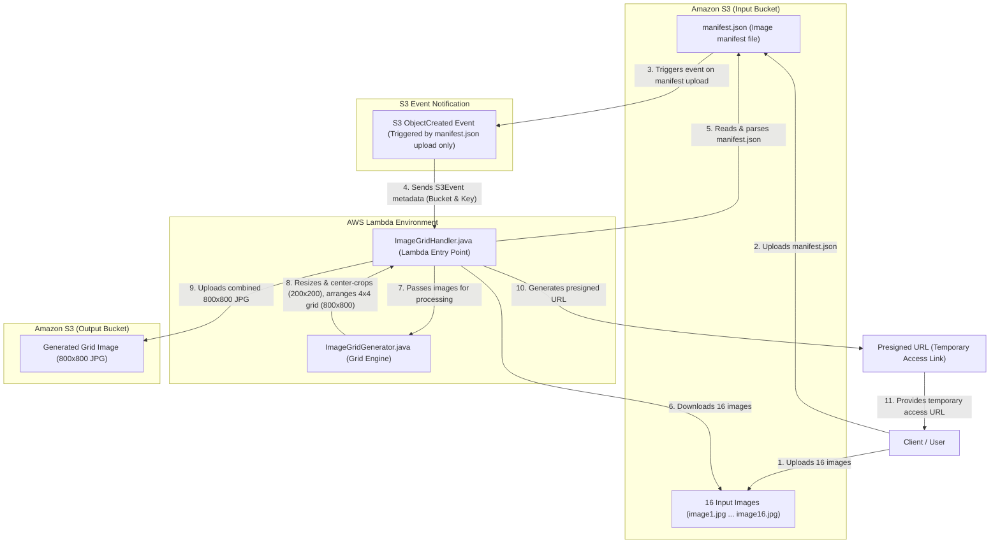

# Image Grid Generator (AWS Lambda)

A Java 21-based AWS Lambda service designed to read and combine multiple images into a unified image grid. Supports local execution for development and testing, as well as deployment to AWS Lambda for cloud execution.

---

## 📌 Features

- **Image Processing**: Reads and processes image files using standard Java 2D APIs (`BufferedImage`, `ImageIO`).
- **AWS Lambda Ready**: Includes AWS Lambda Handler implementing `RequestHandler`.
- **Local Runner**: Run and test image processing locally using `Main.java` without deploying to AWS.
- **Maven Fat JAR Build**: Pre-configured `maven-shade-plugin` to package all dependencies into a single deployable JAR.
- **AWS S3 Integration**: Pre-configured with AWS SDK v2 for Amazon S3 to fetch input images and save generated grids in the cloud.

---

## 🏗️ System Architecture

The following diagram illustrates the complete serverless workflow for generating the image grid using AWS Lambda and Amazon S3:



### Architecture Highlights

1. **S3 Input Bucket**:
   - Stores exactly 16 input images to be processed into a grid.
   - Stores `manifest.json` which specifies the image filenames and grid ordering.
2. **S3 Event Notification**:
   - Configured with an event filter to trigger **only** when `manifest.json` is uploaded (`s3:ObjectCreated:*`).
   - Dispatches an asynchronous `S3Event` notification to AWS Lambda containing the S3 bucket name and manifest key.
3. **ImageGridHandler.java (AWS Lambda Entry Point)**:
   - Receives the `S3Event` (event metadata, not raw image bytes).
   - Identifies the S3 bucket name and manifest object key from the event records.
   - Downloads and reads `manifest.json`.
   - Downloads the 16 input images from S3 into memory.
4. **ImageGridGenerator.java**:
   - Resizes and center-crops each image to **200 × 200 pixels** (preserving aspect ratio and cropping center).
   - Arranges all 16 images into a balanced **4 × 4 grid**.
   - Composites and generates one consolidated **800 × 800 pixel JPG** image.
5. **S3 Output Bucket**:
   - Stores the final generated 800 × 800 JPG image uploaded by the Lambda function.
6. **Presigned URL**:
   - Generates a secure, temporary Presigned S3 URL allowing the client to view or download the output image directly.

---

## 📂 Project Structure

```text
image-grid-generator/
├── pom.xml                                        # Maven project dependencies and build plugins
├── README.md                                      # Project documentation
├── .gitignore                                     # Git ignore rules
├── input-images/                                  # Sample images for local testing
└── src/
    ├── main/
    │   ├── java/
    │   │   └── com/
    │   │       └── example/
    │   │           └── imagegrid/
    │   │               ├── ImageGridGenerator.java # Image loading and grid generation logic
    │   │               ├── ImageGridHandler.java   # AWS Lambda entrypoint (RequestHandler)
    │   │               └── Main.java               # Local testing runner
    │   └── resources/                             # Application configurations
    └── test/
        └── java/
            └── com/
                └── example/
                    └── imagegrid/
                        └── ImageGridHandlerTest.java # Unit tests
```

---

## ⚙️ Prerequisites

- **Java JDK 21** or later
- **Apache Maven 3.8+** (or IDE built-in Maven in IntelliJ IDEA / VS Code / Eclipse)
- **AWS Account & CLI** (Optional, for deploying to AWS Lambda)

---

## 🚀 Getting Started

### 1. Local Testing

You can test the image reading and processing logic locally using `Main.java`:

1. Place your sample images inside the `input-images/` directory.
2. Open the project in your IDE (IntelliJ IDEA or VS Code).
3. Run `com.example.imagegrid.Main`:
   ```bash
   cd image-grid-generator
   # Or run Main.java directly from your IDE
   ```
4.To compile = mvn clean compile
5.To Run = java -cp target/classes com.example.imagegrid.Main


### 2. Building for AWS Lambda (Fat JAR)

To package the project into a single deployable JAR containing all dependencies:

```bash
cd image-grid-generator
mvn clean package
```

The compiled JAR will be located at:
```text
target/image-grid-generator-1.0-SNAPSHOT.jar
```

---

## ☁️ AWS Lambda Configuration

When deploying the generated JAR to AWS Lambda, configure the following settings:

| Setting | Value |
| :--- | :--- |
| **Runtime** | Java 21 |
| **Handler** | `com.example.imagegrid.ImageGridHandler::handleRequest` |
| **Architecture** | `x86_64` or `arm64` |
| **Memory** | 512 MB – 1024 MB (depending on image resolution) |
| **Timeout** | 30 – 60 seconds |

---

## 📦 Key Dependencies

- **AWS Lambda Java Core**: `com.amazonaws:aws-lambda-java-core:1.2.3`
- **AWS Lambda Java Events**: `com.amazonaws:aws-lambda-java-events:3.14.0`
- **AWS SDK for S3**: `software.amazon.awssdk:s3:2.29.20`
- **JUnit 5**: `org.junit.jupiter:junit-jupiter:5.10.2`
